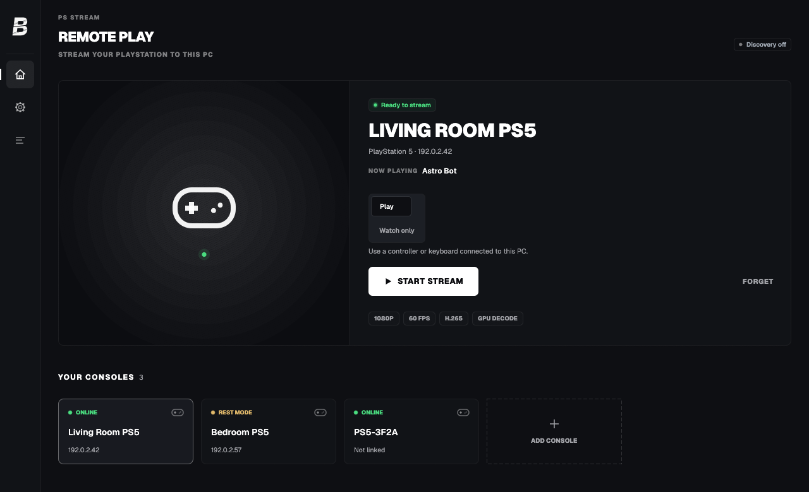
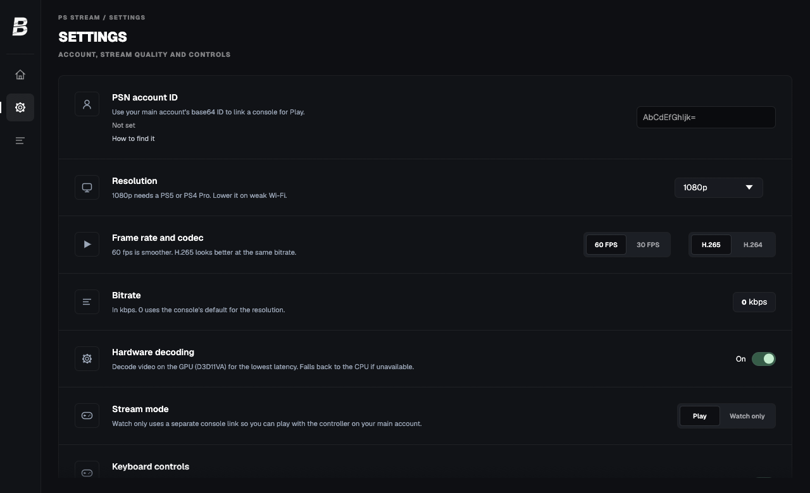

# Bakery PS Stream

Play PS5 and PS4 games over your local network on a Windows PC. Use **Play** for PC gamepad or keyboard controls, or **Watch only** to keep playing on the console while the PC displays the stream.



## Download

1. Download the **Windows x64 ZIP** from [GitHub Releases](https://github.com/TheMuffinMann324/bakery_ps_stream/releases/latest).
2. Extract the whole ZIP and run `ps-stream.exe` from the extracted folder. Keep the DLLs alongside the executable.
3. Use Windows 10 or 11 (64-bit), a PC and console on the same trusted local network, and a PlayStation Network account. Install the [Microsoft Visual C++ x64 Redistributable](https://learn.microsoft.com/en-us/cpp/windows/latest-supported-vc-redist) if Windows reports a missing Visual C++ runtime.

## Link a console

1. Enable **Remote Play**. On PS5, go to **Settings → System → Remote Play**. On PS4, go to **Settings → Remote Play Connection Settings** and activate the console as your primary PS4 under **Account Management**.
2. In **Settings** in Bakery PS Stream, paste your base64 PSN account ID. See the [chiaki-ng account ID and pairing guide](https://chiaki-ng.github.io/chiaki-ng/setup/configuration/#registering-your-playstation).
3. Select your console and click **Link console**. If discovery misses it, choose **Add console** and enter its local IP address.
4. Enter the 8-digit code from **Link Device** on PS5 or **Add Device** on PS4. After linking, click **Start stream**.

To wake a linked console, enable network wake and internet access in the console’s rest-mode settings. If a stream stutters, try Ethernet or reduce the resolution, bitrate, or frame rate. Base PS4 models support up to 720p, and PS4 streams use H.264.

## Watch while playing on the console

1. Sign in to the console with a second PSN account and enable Remote Play.
2. In Bakery PS Stream, select **Watch only → Link for Watch only** and use the second account’s ID and linking code.
3. Click **Watch stream**. Use the controller connected to the console with your main account.

Disconnect before switching modes. **F1** opens the stream menu and keyboard mapping. **F11** toggles fullscreen, and **Esc** returns to windowed mode.

<details>
<summary>Stream settings screenshot</summary>



</details>

## Build from source

Install Git, stable x64 MSVC Rust with `rustfmt` and `clippy`, Python 3.13, and Visual Studio 2022 or later with **Desktop development with C++**, **C++ CMake tools for Windows**, and **vcpkg package manager**.

```powershell
git clone https://github.com/TheMuffinMann324/bakery_ps_stream.git
cd bakery_ps_stream
.\setup.ps1
cargo run --release --locked
```

Setup fetches the pinned submodules used by the build, applies the Windows patches, creates a Python virtual environment, and installs the native dependencies. To build from a release, use its complete source ZIP with the submodule contents included.

```powershell
cargo fmt --all -- --check
cargo clippy --locked --all-targets -- -D warnings
cargo test --locked
```

## Privacy and security

Bakery PS Stream uses Windows Data Protection API (DPAPI) to protect settings and pairing credentials under your Windows account. The app upgrades existing local settings when first opened. Keep the configuration in `%APPDATA%\ps-stream\config` and any log exports private. Send vulnerability reports using the instructions in [SECURITY.md](SECURITY.md).

## Credits and licence

Maintained by [Muffin](https://github.com/TheMuffinMann324). Remote Play discovery, registration, and streaming are powered by **libchiaki** from [chiaki-ng](https://github.com/streetpea/chiaki-ng), maintained by StreetPea and contributors and based on [Chiaki](https://github.com/thestr4ng3r/chiaki) by Florian Märkl (thestr4ng3r). The interface uses [Geist](https://github.com/vercel/geist-font) by the Geist Project Authors under the [SIL Open Font License](assets/fonts/OFL.txt). See [THIRD_PARTY_NOTICES.md](THIRD_PARTY_NOTICES.md) for more credits.

Bakery PS Stream is licensed under the [GNU Affero General Public License v3.0](LICENSE). Each GitHub release includes corresponding source. PlayStation, PS4 and PS5 are trademarks of Sony Interactive Entertainment. Bakery PS Stream is an independent project.
